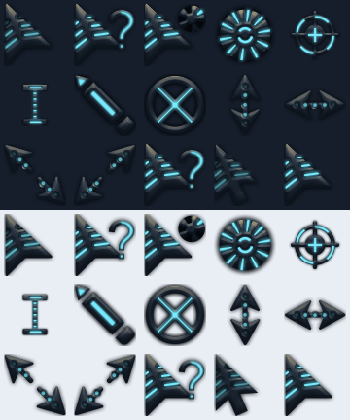

# Kinetik JARVIS

Unofficial cyan / graphite / gold recolor of Kinetik Aqua for **Linux, NixOS and Windows**: 15 animations, 203 source frames; Linux-only roles reuse the art through aliases.

Windows keeps the 64×64 shapes, transparency, hotspots and timing; only visible colors and bad RIFF lengths change. Linux exports nominal 24/32/48/64/96 px drawn at 1.5× (36–144 px; `ZOOM` in `src/kinetik_jarvis/xcursor.py`), with scaled hotspots and millisecond-rounded delays. Unzoomed 64 px pixels match the source after alpha premultiplication.



Preview rows: Normal / Help / Working / Busy / Precision; Text / Handwriting / Unavailable / Vertical / Horizontal; Diagonal 1 / Diagonal 2 / Move / Alternate / Link.

## Windows

1. Right-click `install.inf` → **Install** (Windows 11: **Show more options** first); approve the prompt.
2. **Mouse Properties → Pointers → Kinetik JARVIS → Apply**.

Installs to `%WINDIR%\Cursors\Kinetik-JARVIS` without activating or overwriting another scheme; select your previous scheme to switch back.

## Linux

```sh
mkdir -p ~/.local/share/icons
cp -a Kinetik-JARVIS ~/.local/share/icons/
```

`cp -a` keeps the alias symlinks. Select **Kinetik JARVIS** in cursor settings, or set before your session starts:

```sh
export XCURSOR_THEME=Kinetik-JARVIS
export XCURSOR_SIZE=32
```

Desktop settings may override these variables; restart apps or log out/in. WSL installs affect Linux apps, not the Windows pointer.

## NixOS

Copy this folder beside your configuration (git-backed flakes must track it) and add:

```nix
imports = [ ./Kinetik-JARVIS/nixos.nix ];
```

Rebuild and log out/in. The module installs the theme and selects it at 32 px, also as the fallback theme. Package only (also works with Home Manager):

```nix
environment.systemPackages = [ (pkgs.callPackage ./Kinetik-JARVIS/default.nix { }) ];
```

Build the package from the repository root:

```sh
nix build --impure --expr 'let pkgs = import <nixpkgs> {}; in pkgs.callPackage ./Kinetik-JARVIS/default.nix {}'
```

## Rebuild / test

Python 3.10+, standard library only; needs the original Aqua files:

```sh
python3 src/build_kinetik_jarvis.py --source /path/to/kinetik-aqua-x
KINETIK_SOURCE=/path/to/kinetik-aqua-x python3 -m unittest discover -s src -p 'test_kinetik_jarvis.py' -v
```

One build writes both platforms; `--output <directory>` changes the destination. Without `KINETIK_SOURCE`, integration tests use the sibling Aqua directory or skip; an explicit source must contain all 15 animations. See the repository [source layout and tests](../README.md#source--tests).

Format verified with libXcursor 1.2.3; NixOS options checked against nixpkgs `1d060086d60cb76a40cf37109f979d88a5bd6396`.
