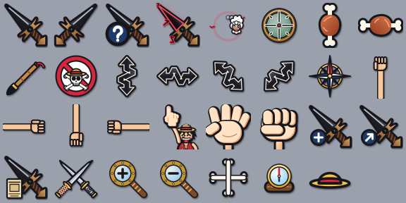

# Cursor themes

- **[Kinetik JARVIS](Kinetik-JARVIS/README.md)** — cyan / graphite / gold Kinetik Aqua recolor for Linux, NixOS and Windows.
- **One Piece** — illustrated Linux and Windows cursors; below.

## One Piece



| Cursor | Artwork |
| --- | --- |
| Normal | Yoru with an animated shine |
| Working | Haki-coated Yoru |
| Busy | Gear 5 Luffy in a Haki ring |
| Link | Chibi Luffy pointing |
| Text | Meat on the bone |
| Grab / grabbing | Gear 3 hand |
| Unavailable | Shaking Jolly Roger |
| Resize | Static, double-ended charcoal ribbons |
| Move | Compass |
| Precision | Sogeking's scope |

### Linux

```sh
mkdir -p ~/.icons
ln -s "$PWD/OnePiece" ~/.icons/OnePiece
```

Select `OnePiece` in cursor settings or set `XCURSOR_THEME=OnePiece`. Pointer, text, resize and grab cursors render at 1.5× nominal size; link at 2×.

### Windows

1. Right-click `OnePiece/install.inf` → **Install** (**Show more options** if needed); approve the prompt.
2. **Mouse Properties → Pointers → One Piece → Apply**.

Installs `.cur` / `.ani` files to `%WINDIR%\Cursors\OnePiece`; no helper needed. Reinstall to update; select another scheme to switch back. The installer doesn't back up your selection.

Old directional helper installed? Exit it and disable **OnePieceDirectionalResize** in **Settings → Apps → Startup**; the installer doesn't stop it.

### Build

Requires `xcursorgen`, `rsvg-convert` and Python/Pillow:

```sh
nix shell --impure --expr 'with builtins.getFlake "nixpkgs"; with legacyPackages.${builtins.currentSystem}; [ xcursorgen librsvg (python3.withPackages (p: [ p.pillow ])) ]' -c python3 src/build.py
```

Regenerates `OnePiece/` (Linux `cursors/`, Windows files, `install.inf`, `preview.png`) and keeps unrelated files. `--output <directory>` changes the destination.

## Source / tests

- `src/theme.py` — shared catalog, Linux aliases/theme files, Windows installers.
- `src/one_piece/` — SVG art, CUR/ANI/XCursor encoding, preview, build.
- `src/kinetik_jarvis/` — ANI recoloring, XCursor encoding, preview, build.
- `src/build.py`, `src/build_kinetik_jarvis.py` — command-line entry points.

One Piece's installer activates its scheme; Kinetik's only registers it.

Tests need Python 3.10+, no rendering tools:

```sh
python3 -m unittest discover -s src -p 'test_*.py' -v
```

Kinetik integration tests need the original Aqua files; see [rebuild](Kinetik-JARVIS/README.md#rebuild--test).
