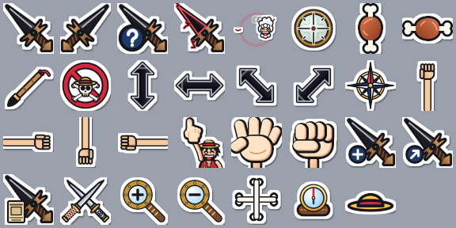

# Cursor themes

- **[Kinetik JARVIS](Kinetik-JARVIS/README.md)** — cyan / graphite / gold Kinetik Aqua recolor for Linux, NixOS and Windows.
- **One Piece** — illustrated Linux and Windows cursors; instructions below.

## One Piece



| Cursor | Artwork |
| --- | --- |
| Normal | Yoru with an animated shine |
| Working | Haki-coated Yoru |
| Busy | Gear 5 Luffy in a Haki ring |
| Link | Chibi Luffy pointing |
| Text | Meat on the bone |
| Grab / grabbing | Gear 3 hand |
| Unavailable | Shaking Jolly Roger |
| Resize | Static, double-ended charcoal ribbons |
| Move | Compass |
| Precision | Sogeking's scope |

### Linux

```sh
mkdir -p ~/.icons
ln -s "$PWD/OnePiece" ~/.icons/OnePiece
```

Select `OnePiece` in cursor settings or set `XCURSOR_THEME=OnePiece`. Pointer, text, resize and grab cursors render at 1.5× nominal size; link renders at 2×.

### Windows

1. Right-click `OnePiece-Windows/install.inf` → **Install** (**Show more options** if needed); approve the prompt.
2. **Mouse Properties → Pointers → One Piece → Apply**.

Native `.cur` / `.ani` files install to `%WINDIR%\Cursors\OnePiece`; no helper is needed. Reinstall to update; select another scheme to switch back. The installer does not back up your selection.

If you installed the old directional helper, exit it and disable **OnePieceDirectionalResize** in **Windows Settings → Apps → Startup**; the installer does not stop it.

Four resize ribbons cover horizontal, vertical and diagonal axes, with shared cursors on opposite edges and Yoru's shading, outline and shadow.

### Build

Requires `xcursorgen`, `rsvg-convert` and Python/Pillow. With Nix:

```sh
nix shell --impure --expr 'with builtins.getFlake "nixpkgs"; with legacyPackages.${builtins.currentSystem}; [ xcursorgen librsvg (python3.withPackages (p: [ p.pillow ])) ]' -c python3 src/build.py
```

Regenerates `OnePiece/`, `OnePiece-Windows/` and `src/preview.png`. Installation needs no build tools.
