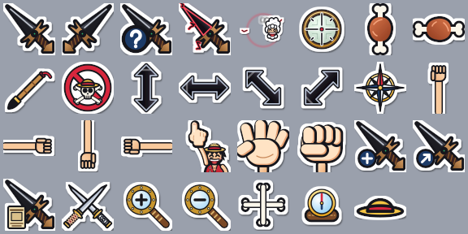
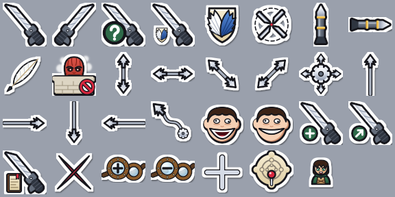

# Anime cursors

Cursor themes for Linux (XCursor) and Windows (`.cur` / `.ani`), generated from one script.

## One Piece



| Cursor | Look |
| --- | --- |
| Normal | Mihawk's Yoru, a shine runs down the blade |
| Working | Yoru coated in Haki |
| Busy | Gear 5 Luffy orbiting in a Haki ring |
| Link | Chibi Luffy pointing |
| Text | Meat on the bone |
| Grab / grabbing | Gear 3 giant hand |
| Not allowed | Jolly Roger shaking "no" |
| Move | Compass |
| Precision | Sogeking's scope |

## Attack on Titan



| Cursor | Look |
| --- | --- |
| Normal | ODM gear sword, a shine runs down the blade |
| Working | The sword with a little Wings of Freedom spinning |
| Busy | Wings of Freedom emblem spinning like a tossed coin |
| Link | Grappling anchor shot out, its wire whipping back to the gear |
| Text | Thunder spear |
| Grab / grabbing | Smiling Pure Titan, mouth open / teeth shut and chewing |
| Not allowed | Colossal Titan rising over the Wall |
| Move | ODM gear firing anchors four ways |
| Resize / arrows | Wire with an anchor on each end / on one end |
| Precision | Four blade tips closing on the nape |
| Zoom | Hange's goggles |
| Pin (Windows) | Pin dropping onto Shiganshina on a map of the Walls |

## Linux

```sh
ln -s "$PWD/OnePiece" ~/.icons/OnePiece            # or AttackOnTitan
```

Then set the theme, e.g. `XCURSOR_THEME=OnePiece` / `hyprctl setcursor AttackOnTitan 24`.
On Linux the pointer, text and grab cursors are drawn 1.5x and the link cursor 2x the nominal size.

## Windows

Copy `OnePiece-Windows` or `AttackOnTitan-Windows` to the PC, right-click `install.inf` → **Install**, then pick the
**One Piece** or **Attack on Titan** scheme in Mouse settings → Pointers. Untested on Windows so far.

## Build

Needs `xcursorgen`, `rsvg-convert` (librsvg) and Python with Pillow. With Nix:

```sh
nix shell --impure --expr 'with builtins.getFlake "nixpkgs"; with legacyPackages.${builtins.currentSystem}; [ xcursorgen librsvg (python3.withPackages (p: [ p.pillow ])) ]' -c python3 src/build.py
```

This rewrites every theme's two folders and `src/<theme>/preview.png`; pass theme names (`onepiece`, `aot`) to build
only those. A theme is a package under `src/` with `NAME`, `TITLE` and `CURSORS`; shared drawings live in `src/common.py`.
